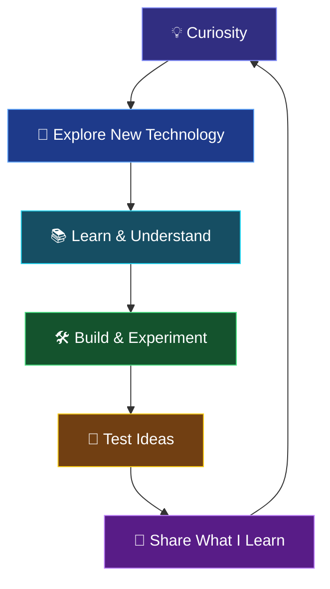

import pypandoc

readme = r'''

# 👋 Hey, I'm Uncle Rafee

### Curious Mind · AI Explorer · Tech Enthusiast

**Learn. Build. Explore. Share.**

I’m passionate about discovering how technology works, experimenting with new ideas, and sharing what I learn along the way.

---

## 🧑‍💻 A Little About Me

- 🤖 Exploring **Artificial Intelligence** and the latest AI tools
- 🧠 Learning about **AI agents, agentic workflows, and automation**
- 💻 Interested in **software development** and building useful projects
- 🔍 Always curious about emerging technologies and how things work
- 🎥 Sharing tech discoveries, experiments, and learning experiences through **Uncle Rafee**

I believe you don't have to know everything to start building. Stay curious, keep experimenting, and improve one step at a time.

## 🗺️ My Tech Journey

## 🚀 What I'm Exploring

| Area | What interests me |
|---|---|
| 🤖 Artificial Intelligence | AI models, practical AI tools, and new developments |
| 🧩 Agentic AI | AI agents, workflows, and intelligent automation |
| 💻 Development | Programming, web technologies, and building projects |
| ⚙️ Automation | Connecting tools and simplifying repetitive tasks |
| 🎬 Tech Content | Making technology easier to understand and sharing discoveries |

## 🧰 Tools & Technologies

*My toolkit is always evolving as I learn and experiment.*

  

## 📊 GitHub at a Glance

  
  

  

## 🎥 Beyond the Code

### Uncle Rafee

I share my journey through the world of technology — exploring AI tools, learning new concepts, experimenting with ideas, and discovering what’s possible.

**The goal isn't to know it all. It's to keep learning and share the journey.**

---

### 🌱 Always learning. Always building.

**Thanks for stopping by!**

'''

output_path = "/mnt/data/README.md"
pypandoc.convert_text(readme, "md", format="md", outputfile=output_path, extra_args=["--standalone"])
print(f"Created: {output_path}")
